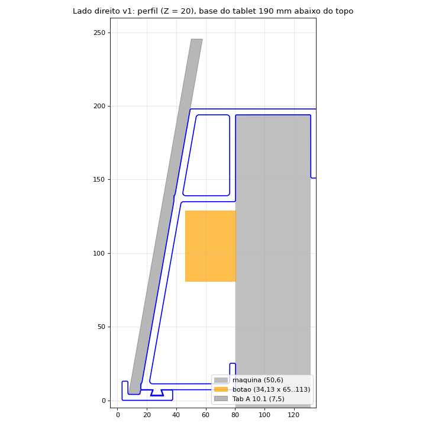

# Tablet stand for the Meticulous (espresso)

A parametric tablet stand, generated by a Python script, that hangs a tablet in front of the **Meticulous** espresso machine. It fits over the top edge of the machine, with no screws and no glue.

The idea came from the *Meticulous tablet stand left*, shared by **Maurin** on the Meticulous Discord. This version was rebuilt from scratch in code (none of his files are here), split into two parts that print without supports and with adjustable dimensions.



## What it is

- **Frame**: hangs on the top edge of the machine by a hook, and the tablet leans against it. Prints lying flat.
- **Ledge**: the step the tablet stands on. It slides into the frame on a **20° dovetail**, with a stop at one end. Prints lying flat.
- **Left side** (`left_stand.py`): tablet to the left of the group head.
- **Right side** (`right_stand.py`): tablet in front of the screen and the button. The frame forms a "window" around the *push to brew* button so nothing touches it. The ledge runs from the frame outwards, away from the machine.
- **Tilt compensation**: the ledge sags a little under the tablet's weight. The ledges can be made with an upward angle that cancels out once the tablet sits on them. The "straight" version (`ledge_straight.py`) puts the angle only in the joint, so the ledge looks straight.
- **USB-C cable**: there is a ledge with a slit and a pocket for a **90° USB-C adapter** (body 19.2 × 12.8 × 8.2 mm), with the cable leaving behind the tablet (`ledge_cable_back.py`).

## Tested and untested

Everything was printed in PETG on an Anycubic Kobra S1, 0.4 nozzle.

| Item | Status |
|---|---|
| Right frame, base 190 mm below the top (`stl/tablet_stand_right_v1_frame.stl`) | **Printed and in use.** Good fit on the machine. |
| Dovetail with 0.30/0.15 mm clearance per side | Too loose. |
| Dovetail **0.10 mm along the run and 0.00 in the last 8 mm, 0.08 layer** | **Firm** (approved). |
| 2.5° ledge (bent floor), tablet in portrait | Ended up with about 1° of tilt; in use. |
| 5° ledge, tablet in landscape (0.20/0.10 fit) | Ended up at 0°. |
| 3.5° straight ledge with the tight fit | Overshot: ended up at −2°. |
| Ledge with a pocket for the adapter and the cable at the back (1.5°) | **Untested.** The position of the plug on the adapter body is estimated. |
| v2 frame, taller for the tablet in landscape (base 142) | **Untested.** |
| Left side | **Untested.** |

The measurements used were taken from **one** machine, with calipers:
- Depth of the top, where the hook grips: **50.6 mm**.
- Button: from **65.07 to 113.08 mm** below the top, protruding **34.13 mm** from the face.

Tablet used: Galaxy Tab A 10.1 (2019), **245.2 × 149.4 × 7.5 mm**, no case. **Measure your machine and your tablet before printing.**

## Making your own

1. Install Python 3 and `pip install trimesh shapely manifold3d numpy matplotlib`.
2. Measure your machine, your tablet (with its case, if you will use one) and the position of the button.
3. Generate the parts:

   ```
   python -I right_stand.py base=190 gap=8.1 column=50.6 run_clearance=0.10 end_clearance=0.0
   ```

   The STLs go to `stl/`. All the parameters are at the top of each script and in `CLAUDE.md`.
4. Slice them in your slicer, or build the 3MF with `make_3mf.py`. That script is made for the Kobra S1 with the profile in `slicer/`. For another printer, use the STLs.

**Easier:** open this folder with Claude Code (or another agent) and tell it your measurements, your tablet and your printer. `CLAUDE.md` explains the project to it.

## Ready-made files

The ready-made files are in `stl/` and in `output/` (3MFs for the Kobra S1, PETG). They are valid **for the measurements above**.

Names:
- `left` / `right`: side of the machine.
- `frame` / `ledge`: part.
- `v2_landscape`: taller frame, for the tablet in landscape.
- `cable_back`: ledge with a pocket for the USB-C adapter.

## License

MIT. Use, modify and share.
