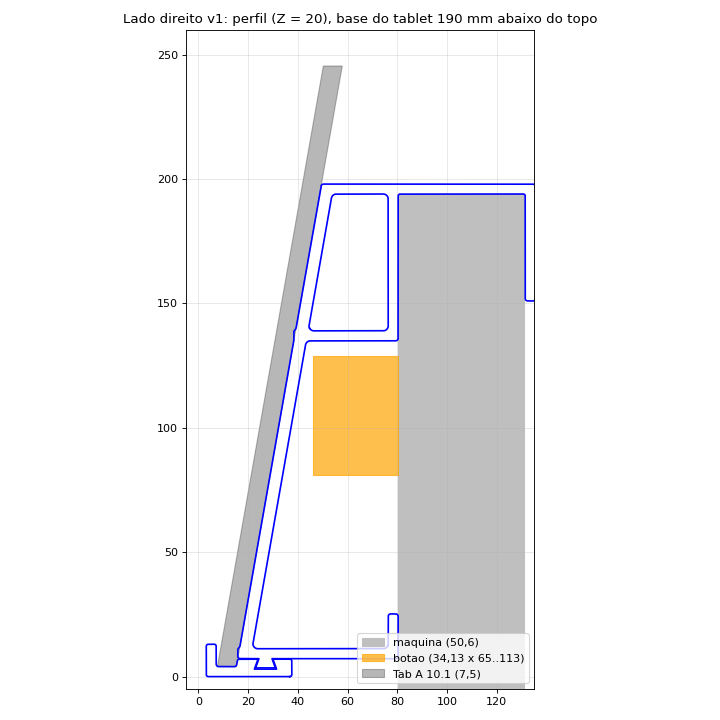

# Suporte de tablet para a Meticulous (espresso)

Suporte paramétrico, gerado por script em Python, para pendurar um tablet na frente da máquina de espresso **Meticulous**. Ele encaixa na quina de cima da máquina, sem parafuso e sem cola.

> **English:** parametric, script-generated tablet stand that hangs on the Meticulous espresso machine. Two printed parts (frame + ledge) joined by a dovetail, no supports needed for most parts. Point your Claude (or any coding agent) at this repo, give it your measurements and it will regenerate the parts. Start with `CLAUDE.md`.

A ideia veio do *Meticulous tablet stand left*, compartilhado pelo **Maurin** no Discord da Meticulous. Esta versão foi refeita do zero em código (nenhum arquivo dele está aqui), dividida em duas peças que imprimem sem suporte e com medidas ajustáveis.



## Como é

- **Quadro**: pendura na quina de cima da máquina por um gancho, e o tablet encosta nele. Imprime deitado.
- **Régua**: o degrau onde o tablet apoia. Encaixa no quadro por um **rabo de andorinha de 20°**, com batente numa ponta. Imprime deitada.
- **Lado esquerdo** (`gerar_suporte.py`): tablet à esquerda da cabeça.
- **Lado direito** (`gerar_suporte_dir.py`): tablet na frente da tela e do botão. O quadro faz uma "janela" em volta do botão *push to brew*, para nada encostar nele. A régua sai do quadro para fora da máquina.
- **Compensação de inclinação**: com o peso do tablet a régua cede um pouco. As réguas podem sair com um ângulo para cima, que é anulado quando o tablet assenta. A versão "reta" (`gerar_regua_reta.py`) põe o ângulo só no encaixe, então a régua parece reta.
- **Cabo USB-C**: há uma régua com rasgo e vão para um **adaptador USB-C de 90°** (corpo 19,2 × 12,8 × 8,2 mm), com o cabo saindo atrás do tablet (`gerar_regua_cabo_tras.py`).

## Testado e não testado

Tudo foi impresso em PETG numa Anycubic Kobra S1, bico 0,4.

| Item | Situação |
|---|---|
| Quadro direito, base 190 mm abaixo do topo (`stl/Suporte_tablet_dir_v1_quadro.stl`) | **Impresso e usado.** Encaixe na máquina bom. |
| Rabo de andorinha 0,30/0,15 mm de folga por lado | Ficou frouxo. |
| Rabo de andorinha **0,10 mm no curso e 0,00 nos últimos 8 mm, camada 0,08** | **Firme** (aprovado). |
| Régua de 2,5° (piso dobrado), tablet em pé | Ficou com cerca de 1° de inclinação; em uso. |
| Régua de 5°, tablet deitado (encaixe 0,20/0,10) | Ficou em 0°. |
| Régua reta de 3,5° com o encaixe justo | Passou do ponto: ficou em −2°. |
| Régua com vão para o adaptador e cabo por trás (1,5°) | **Não testada.** A posição do plugue no corpo do adaptador é estimada. |
| Quadro v2, mais alto para o tablet deitado (base 142) | **Não testado.** |
| Lado esquerdo | **Não testado.** |

As medidas usadas foram tiradas de **uma** máquina, com paquímetro:
- Profundidade do topo, onde o gancho pega: **50,6 mm**.
- Botão: de **65,07 a 113,08 mm** abaixo do topo, saindo **34,13 mm** da face.

Tablet usado: Galaxy Tab A 10.1 (2019), **245,2 × 149,4 × 7,5 mm**, sem capa. **Meça a sua máquina e o seu tablet antes de imprimir.**

## Para fazer a sua

1. Instale Python 3 com `pip install trimesh shapely manifold3d numpy matplotlib`.
2. Meça a sua máquina, o tablet (com a capa, se for usar) e a posição do botão.
3. Gere as peças:

   ```
   python -I gerar_suporte_dir.py base=190 vao=8.1 coluna=50.6 folga_curso=0.10 folga_fim=0.0
   ```

   Os STLs vão para `stl/`. Todos os parâmetros estão no começo de cada script e no `CLAUDE.md`.
4. Fatie no seu fatiador, ou gere o 3MF com `gerar_3mf.py`. Esse script é feito para a Kobra S1 com o perfil em `fatiador/`. Para outra impressora, use os STLs.

**Mais fácil:** abra esta pasta com o Claude Code (ou outro agente) e diga as suas medidas, o seu tablet e a sua impressora. O `CLAUDE.md` explica o projeto para ele.

## Arquivos prontos

Os arquivos prontos ficam em `stl/` e em `saida/` (3MFs para Kobra S1, PETG). Eles valem **para as medidas acima**.

Nomes:
- `esq` / `dir`: lado da máquina.
- `quadro` / `regua`: peça.
- `v2_deitado`: quadro mais alto, para o tablet deitado.
- `cabo_tras`: régua com vão para o adaptador USB-C.

## Licença

MIT. Use, modifique e compartilhe.
